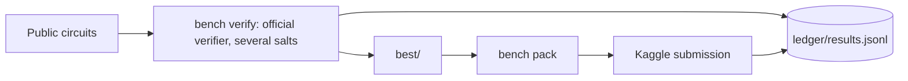
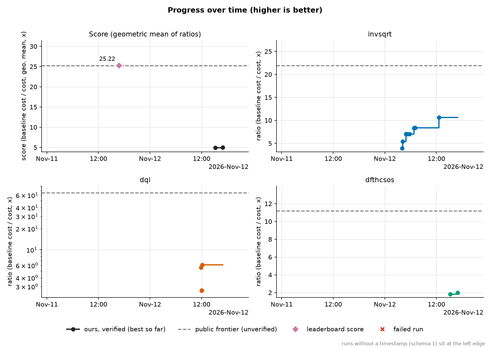
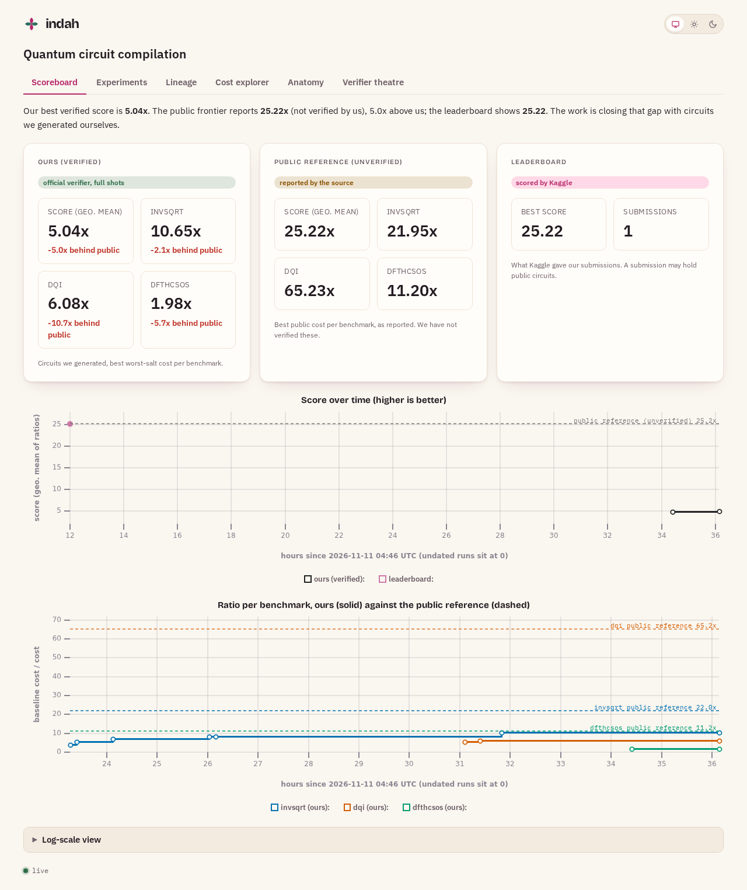
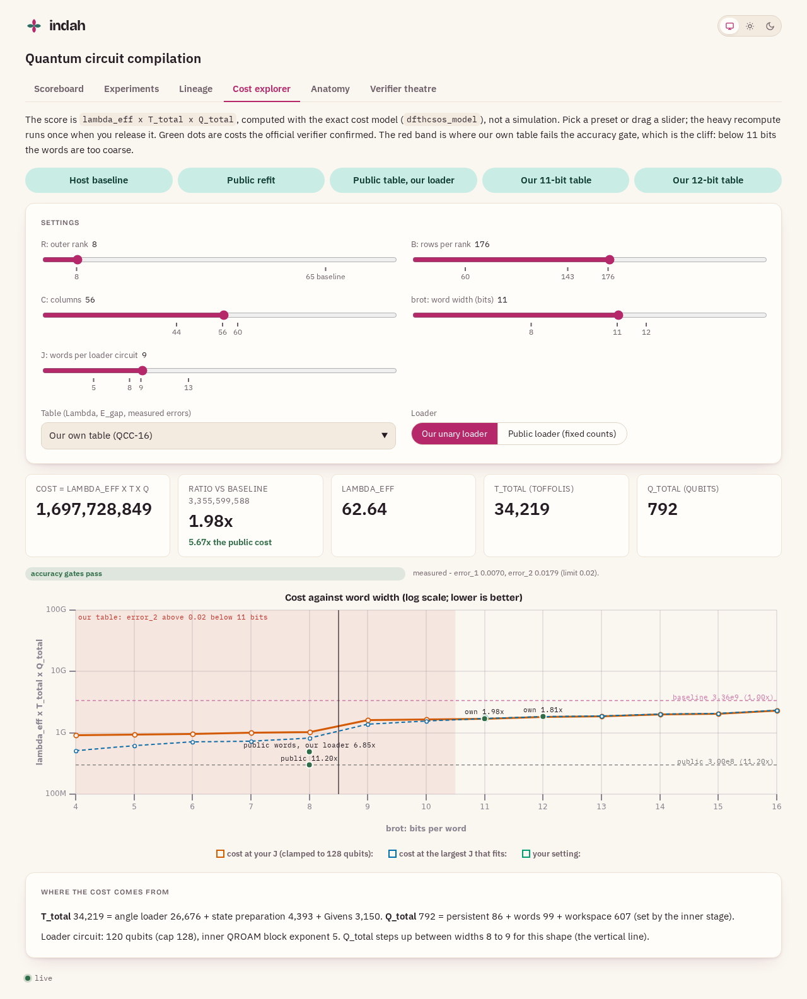
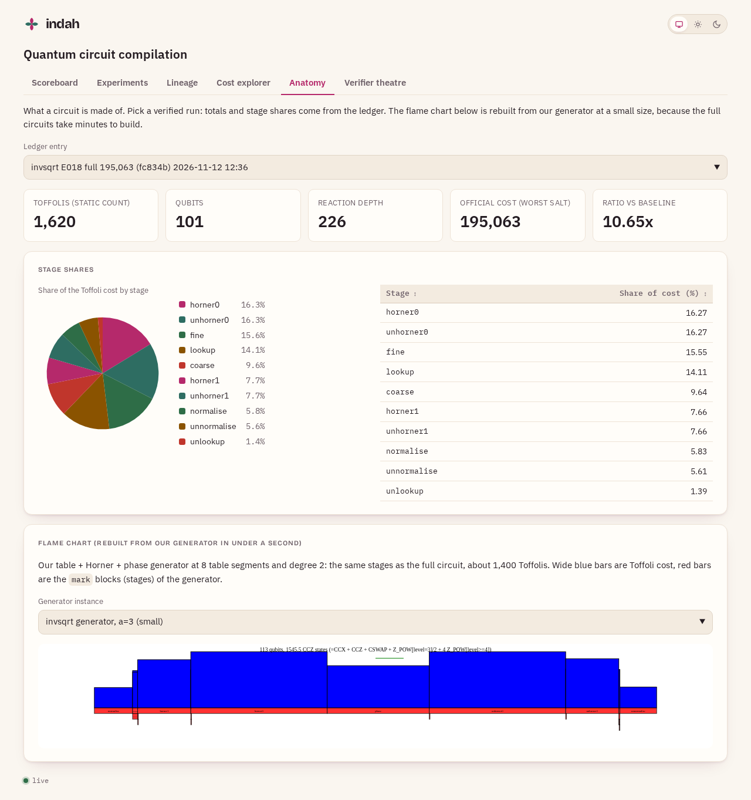
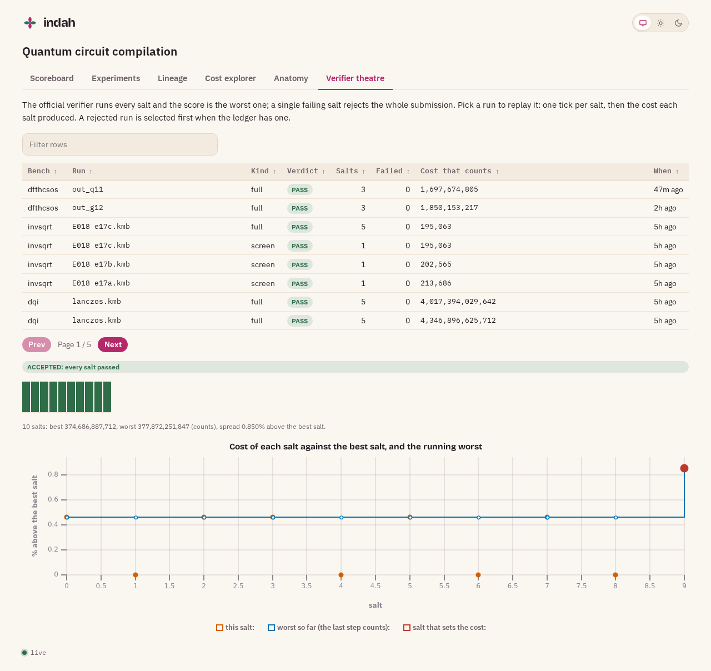
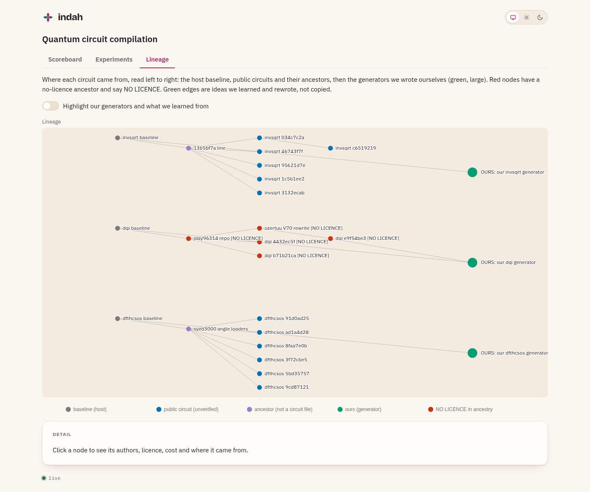

# Verifiable Quantum Circuit Compilation

Our work on Google Quantum AI's [Verifiable Quantum Circuit Compilation](https://www.kaggle.com/competitions/google-verifiable-quantum-circuit-compilation)
Kaggle competition: make three fault-tolerant quantum subroutines cheaper, with every circuit checked
by the official classical verifiers. It has a verification harness with a results ledger, and a
learning site that takes a Python programmer with no quantum background to the point of reading these circuits.

**Status (2026-11-14):** public leaderboard score **25.218**, from a portfolio of other participants'
public circuits that we verified ourselves at several salts. Our own circuits are still behind that
frontier, except on DQI where we are within 3%. Taking over on a new machine? Start with
[docs/HANDOFF.md](docs/HANDOFF.md).

| Benchmark | What it is | Baseline cost | Public circuits in `best/` | Our own best (verified) |
|---|---|---|---|---|
| invsqrt | 1/sqrt(x) phasing for fusion simulations | 2,076,774 | 94,600 (21.95) | 12.34 (E023) |
| dqi | Reed-Solomon decoder for Decoded Quantum Interferometry | 2.44e13 | 3.74e11 to 3.78e11 (about 65) | 3.72e11 (65.77, 890 qubits) |
| dfthcsos | FeMoCo block encoding (chemistry) | 3.36e9 | 2.996e8 (11.20) | 1.34e9 (2.50) |

The score is the geometric mean of the three ratios. Any failed verifier test rejects the whole submission.
The circuits in this entry are other participants' public work; see [docs/PROVENANCE.md](docs/PROVENANCE.md) for authors,
sources and licences as stated.



## Progress

Our verified circuits against the public frontier, drawn from `ledger/` by `bench plots`
([more plots](docs/MEASUREMENT.md)). The local dashboard (`make dashboard`) shows the same story, the
experiment log and where each circuit came from.













To refresh every image above from the current ledger, run `make plots-readme` (needs
`uv sync --extra plots --extra dashboard --extra shots` and once `uv run playwright install chromium`; it
verifies nothing and takes a few seconds), then commit `docs/img/`.

## Quick start

You need [uv](https://docs.astral.sh/uv/) and, for competition data, a Kaggle account with the CLI set up.

```bash
make install          # Python environment, includes kickmix
make check            # lint, types and fast tests (no data needed)
make fetch-data       # competition data into data/ (about 1 GB)
QCC_DATA=$PWD/data uv run bench verify dfthcsos data/sample_submission/dfthcsos --salts 1
```

The last command runs the official dfthcsos verifier on the baseline (a minute alone, several when the machine is busy) and appends a row to
`ledger/results.jsonl`. DQI verification needs 5 to 9 GB of memory; run it on Kaggle with
[notebooks/dqi_verify](notebooks/dqi_verify).

## Learn

New to quantum computing? Start with the [learning site](https://leejianrong.github.io/quantum-circuit-compilation/):
qubits and gates, reversible logic, what the costs mean, how kickmix circuits are verified classically, a primer per
benchmark, and a hands-on page where you build and verify your own circuit.

## Project docs

- [docs/HANDOFF.md](docs/HANDOFF.md): current state, every file that is not in git and where it came from, new-machine setup, GPU work, backlog
- [docs/COMPETITION.md](docs/COMPETITION.md): the competition, scoring and prizes
- [docs/PLAN.md](docs/PLAN.md) and [docs/SLICES.md](docs/SLICES.md): plan and work breakdown
- [docs/MEASUREMENT.md](docs/MEASUREMENT.md): ledger, metrics, plots and the dashboard
- [docs/experiments/](docs/experiments/): one write-up per experiment, positive and negative
- [docs/PROVENANCE.md](docs/PROVENANCE.md) and [THIRD_PARTY_NOTICES.md](THIRD_PARTY_NOTICES.md): every public circuit or source we use, with licence
- [docs/adr/](docs/adr/): decisions and why

## Contributing

Work is tracked on a Pandan board. Conventions (branches, PRs, tests, what never to commit) are in
[AGENTS.md](AGENTS.md); `make hooks` installs the pre-push check.

## License

Apache-2.0 for our code. Competition data is not included. Third-party circuits keep their authors' terms.
