# Measurement, workflow and the dashboard

How we know whether a circuit is better, how an experiment moves from idea to submission, what we
record, what we plot, and how the dashboard tells the story. Decisions are in
[ADR-0008](adr/0008-measurement-ledger-v2-and-dashboard.md). Cards are Epic C on the board
(QCC-39 to QCC-48). The ledger today is `ledger/results.jsonl` (schema 1, `src/bench/ledger.py`).

## What we measure

| Layer | Metric | Source | Why it matters |
|---|---|---|---|
| Official | worst-salt cost and ratio per benchmark; geometric-mean score | official verifiers | the oracle; promotion ranks on the **worst** salt, not the mean |
| Safety | failures per salt; cost spread across salts; margin on accuracy gates (dfthcsos `Lambda`, `E_gap`) | `bench verify` | one failed hidden-seed test rejects the whole submission |
| Structure | Toffoli (CCZ) count, qubits, reaction depth, per-stage share | kickmix `operation_statistics()`, `num_qubits`, `reaction_depth`, `mark` blocks | shows where to cut next |
| Process | verify wall time, screen-to-full pass rate, experiments per day, host | ledger and experiment log | our real throughput |
| Outside | leaderboard score, rank, public-reference costs | `kaggle competitions submissions`, PROVENANCE | the frontier we are chasing |

Rules: a reduced-shot run (`reduced_shots`) never gates promotion. A public-reference row is
**unverified** unless we ran it ourselves (`kind` says which).

## Workflow

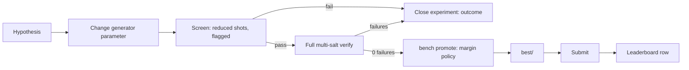

Every attempt is one **experiment** with a hypothesis, a parent circuit hash and an outcome, including
failures. Verification runs link to an experiment, so the dashboard can show attempts, not only wins.
DQI full runs go to Kaggle (ADR-0002); everything else runs locally.

## Parameter sweeps

`bench sweep` runs a generator over a grid (`--param w=4:8 --param g=1,2`) or a seeded random sample
(`--mode random --n 20`). Each point is built from `--gen "<command with {w} {g} {out}>"`, then verified while
holding `/tmp/qcc-heavy.lock` (the same lock as `flock /tmp/qcc-heavy.lock ...`), so sweeps never overlap with
other heavy runs. One ledger row per point (screen rows when `--shots-divisor` > 1); parameters live in
`<out-dir>/sweep.jsonl`, which also makes a rerun skip finished points. Use `--dry-run` to see the commands.
Rank by the worst salt and confirm the winner at full shots before promoting. Background:
[research/workflows.md](research/workflows.md).

## Screening with kickmix-engine (opt-in, never a gate)

`bench verify <bench> <circuit> --engine kickmix-engine` runs the third-party Rust engine
([audit](research/kickmix-engine-audit.md), [parity record](research/kickmix-engine-parity.md)) in place of the
official verifier. It is for screening only: the official verifier stays the oracle and the only gate (ADR-0001).
The row is always `kind=screen` with `engine=kickmix-engine@<commit>`; `bench promote` ignores any row with an
`engine` tag, and `--kind full` or `--shots-divisor` with `--engine` is refused. It runs at full shot counts.

Build it yourself from the audited commit (never a prebuilt wheel), outside this repository:

```
git clone https://github.com/manwithacat/kickmix-engine ~/qcc-tools/kickmix-engine-src
git -C ~/qcc-tools/kickmix-engine-src checkout 166b61d2e0a7404ace8acf62a6f269105e6b97f1
cd ~/qcc-tools/kickmix-engine-src && CARGO_TARGET_DIR=~/qcc-tools/build-target cargo build --release --locked
mkdir -p ~/qcc-tools/stage && cp -r python/kickmix_engine ~/qcc-tools/stage/
cp ~/qcc-tools/build-target/release/lib_engine.so ~/qcc-tools/stage/kickmix_engine/_engine.abi3.so
```

The engine is a Python package with a compiled core, so `QCC_KICKMIX_ENGINE` points at a small launcher you write
(`<launcher> verify <bench> <circuit> --salt S --threads N`), for example:

```
#!/bin/bash
exec /path/to/repo/.venv/bin/python -I -c "import sys; sys.path.insert(0, '$HOME/qcc-tools/stage'); \
from kickmix_engine.cli import main; sys.exit(main())" "$@"
```

Then `export QCC_KICKMIX_ENGINE=<launcher> QCC_KICKMIX_ENGINE_SHA=166b61d2e0a7...`. The child process gets an
allowlisted environment (no tokens) and `KICKMIX_ENGINE_VERIFIERS=$QCC_DATA/verifiers`. Use the pip kickmix from
`uv sync`, never `data/kickmix`. Run it under `flock /tmp/qcc-heavy.lock` like any heavy verify. Before trusting a new
engine commit, re-run the cross-check in the parity record on it.

## Ledger v2

Append-only JSONL. Old rows stay valid. Fields added to schema 1:

| Field | Meaning |
|---|---|
| `schema` | 2 |
| `ts` | UTC ISO timestamp of the run |
| `experiment` | experiment id, or null |
| `parent_sha` | circuit sha256 this one was derived from, or null |
| `kind` | `screen`, `full`, `leaderboard`, `public-reference` |
| `toffolis`, `qubits`, `depth` | from kickmix statistics |
| `stage_shares` | cost share per `mark` block, where the circuit has marks |
| `salt_costs` | cost per salt, in salt order (schema 1 already has `costs`) |
| `leaderboard_score` | set on `kind=leaderboard` rows |
| `engine` | `kickmix-engine@<commit>` on rows made with `--engine`; such rows are never evidence |

`ledger/experiments.jsonl` holds the experiment records (id, hypothesis, benchmark, parent, outcome).

## Plots (matplotlib, `bench plots`, static PNGs in `out/plots/`)

1. Score and per-benchmark ratio over time as a staircase, with the public frontier as a reference line.
2. Cost by stage as stacked bars per circuit.
3. Salt-spread strip plot for each promoted circuit.
4. Pareto scatter of Toffolis against qubits, with iso-cost curves.
5. Experiment funnel: screened, full verified, promoted, submitted.
6. Verify wall time per benchmark and host.

Plots are drawn from the ledger only, with fixture-ledger tests. The committed PNGs live in `docs/img/`
(refresh them with `uv run bench plots --out docs/img`) and appear here and in the README. "Ours" in the
score and ratio plots means verified runs of circuits we generated; verified runs of public circuits are
not counted.

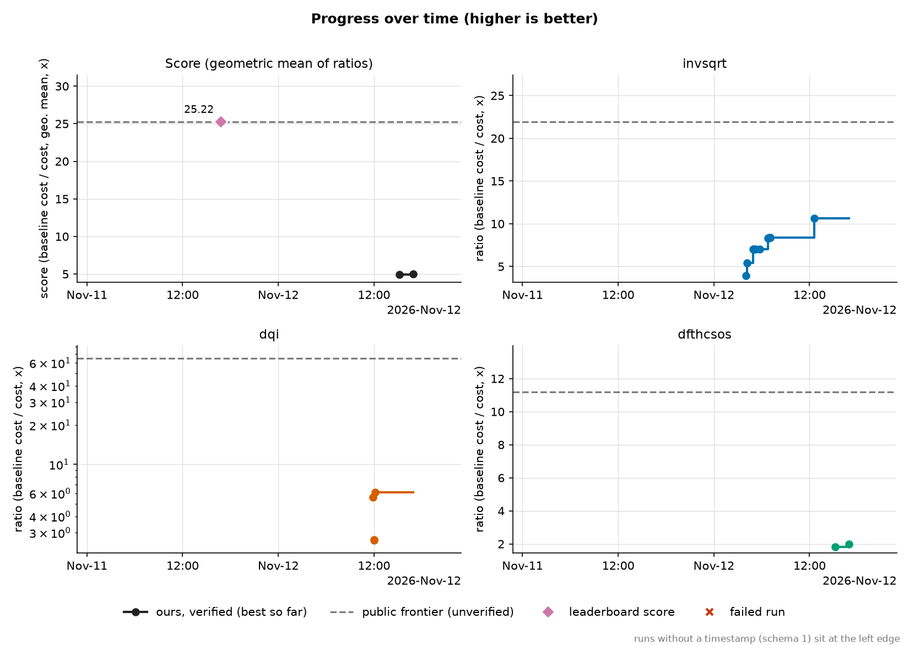

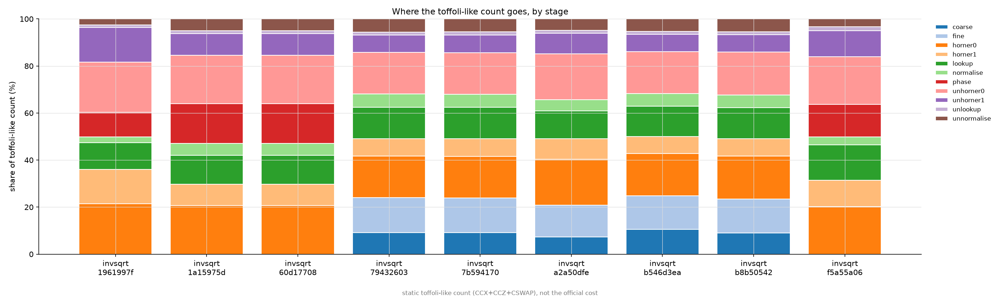

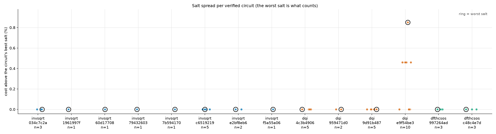

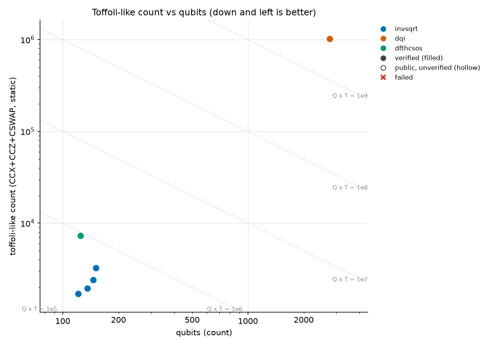

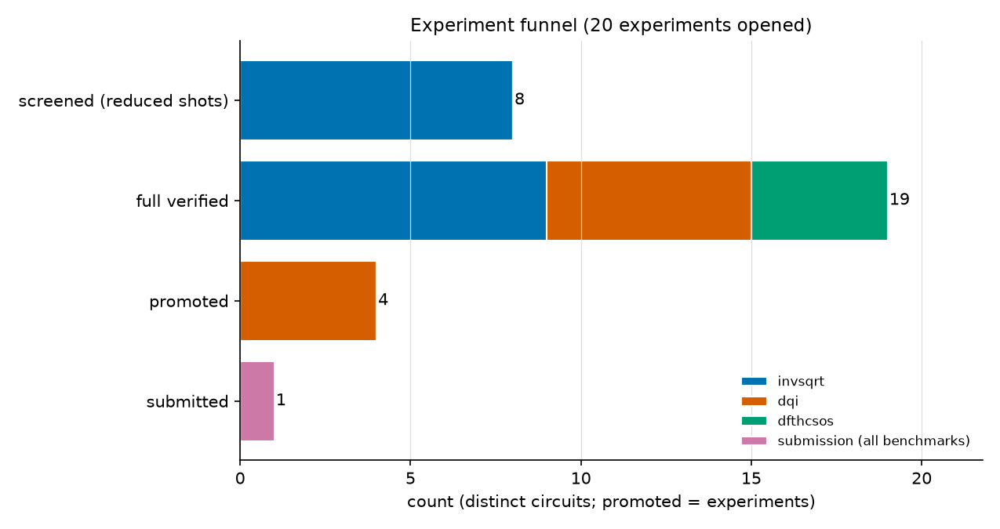

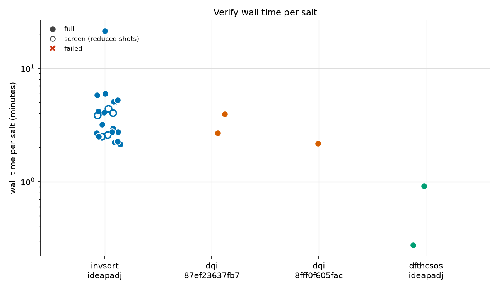

## Dashboard (indah, `dashboard/`, local first)

An optional extra (`uv sync --extra dashboard`), run with `make dashboard`. It reads `ledger/` and nothing
else. Tabs:

| Tab | Shows | Why |
|---|---|---|
| Scoreboard | `Stat` cards for score and ratios; ratio-over-time chart | where we stand |
| Cost explorer | sliders for the dfthcsos cost model (factorization shape, `brot`); redraws `lambda_eff x T_total x Q_total` and the gates | cost is a product, and one knob makes a cliff |
| Anatomy | kickmix flame chart and stage shares for any ledger entry | what a circuit is made of |
| Verifier theatre | per-salt pass/fail ticks and cost spread | why one failure matters |
| Lineage | graph from baseline through public circuits to ours, from `ledger/lineage.json` (derived from PROVENANCE.md by `uv run python -m bench.lineage`); no-licence ancestors in red and labelled, since Graph has no dashed style yet | provenance and what is ours |
| Experiments | table of attempts and outcomes | the story, failures included |

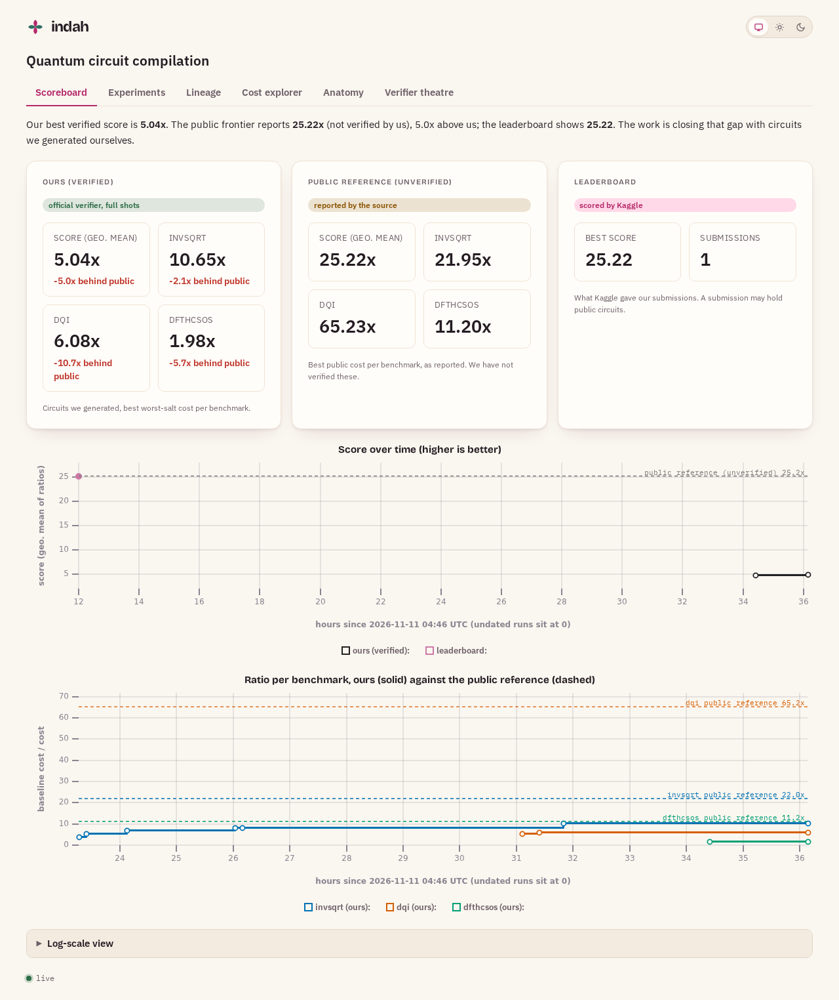

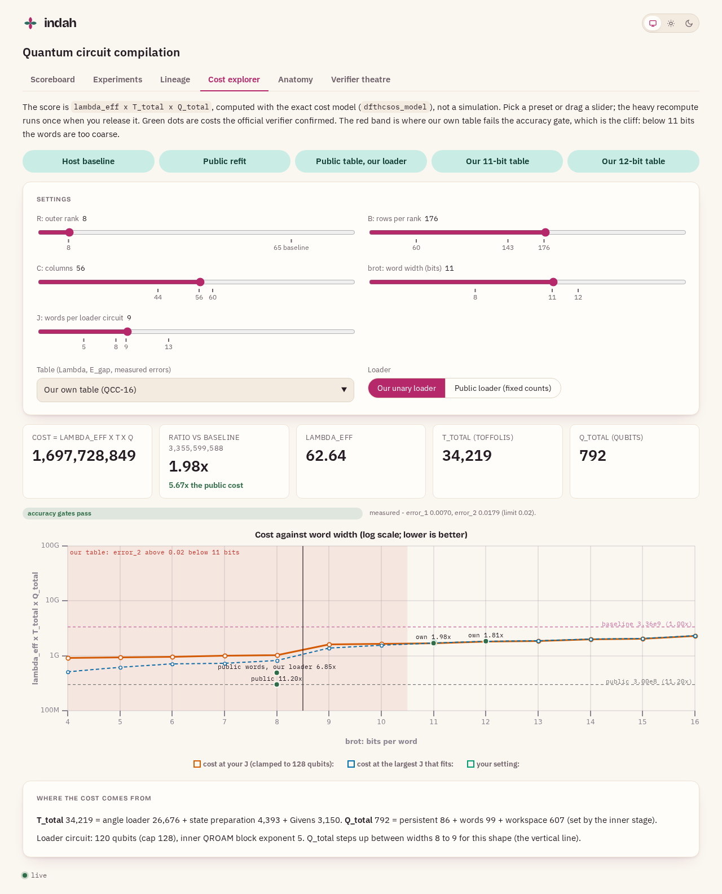

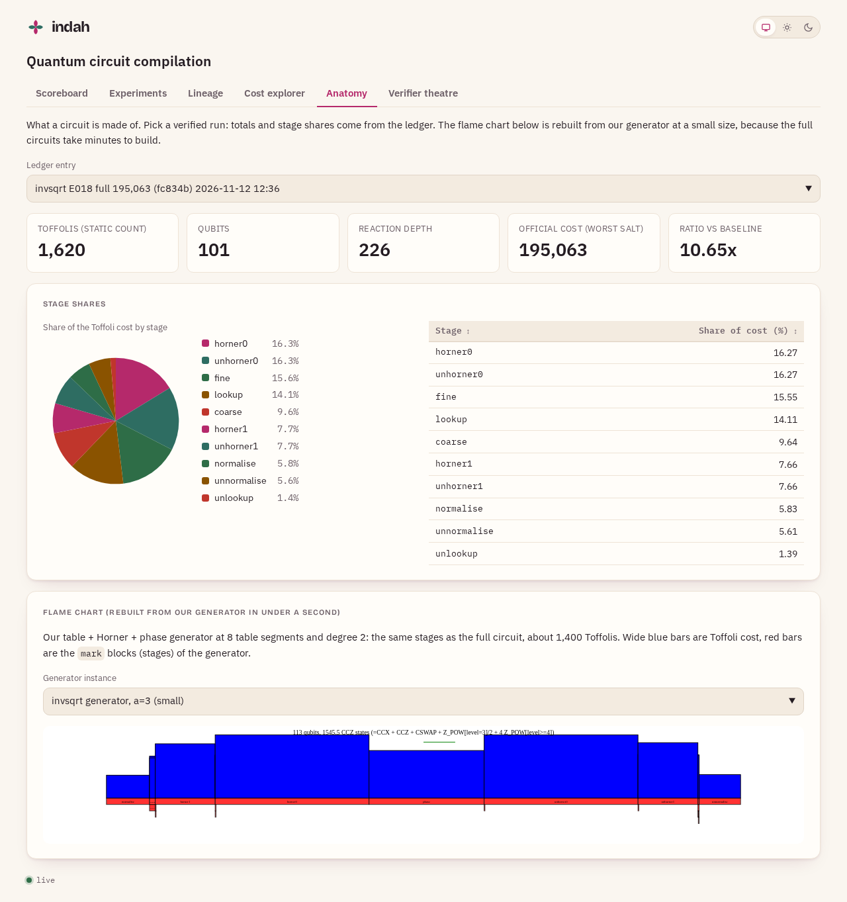

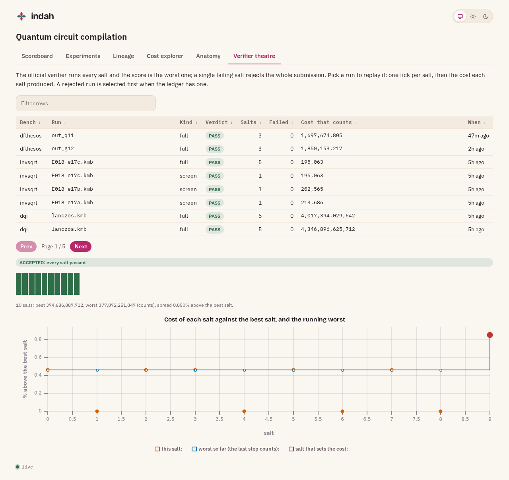

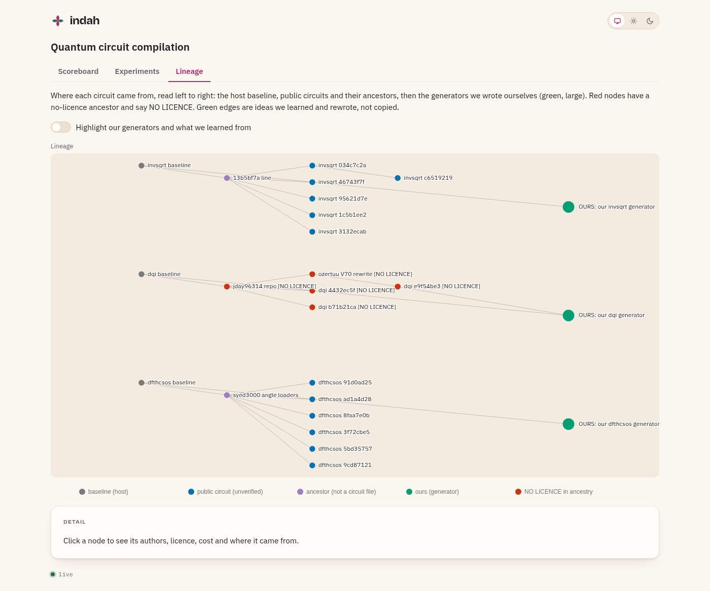

`make plots-readme` redraws these and the six plots above into `docs/img/` from the live ledger
(`scripts/plots_readme.py`). The Scoreboard counts only fully own circuits: a run listed in
`plots.NOT_FULLY_OWN` (our loader on the public words, E001) is shown in the ledger but not as ours.

It is not hosted publicly until we have our own results, because the lineage tab shows third-party
circuits.

## Build order

QCC-39 ledger v2, then QCC-40 experiment log, QCC-41 backfill and leaderboard rows, QCC-42/43 plots,
QCC-44 dashboard scaffold, QCC-46/47 dashboard tabs, QCC-45 cost explorer (needs the cost model from
QCC-14), QCC-48 docs and README.
