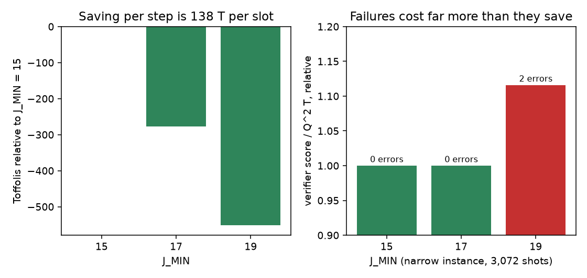

# DQI: how the 889-qubit builder is put together, and where our 2.1% is (QCC-19)

Method: read the source of the best public DQI builder (Apache-2.0) and one recorded build file as data; nothing from it was run.
Tags: **[V]** read from that source or its recorded data, cite file and line; **[M]** measured by us; **[I]** inferred.
Paths below are inside its `dqi_source/src/controller_work/`. Numbers behind every figure are in `analysis/numbers/dqi.json`
(`make report` redraws the figures and the PDF).

## Summary

* [V] Its circuit is 384,003 static Toffolis at 889 qubits; ours is 391,326 at 890 [M]. The 7,323 T gap is **not** one trick. It is
  6,411 T between our vendored base and the base of its final pipeline ("accepted v3", 384,915), plus 912 T of 15 small patches.
* [V] Our vendored kernels come from the older `night_c27` / `night_converter` lineage. Its final build rebinds about 15 modules from
  the newer `after_v3` / `after_c5` lineage (`after_v3/integration_v7/v7_pipeline.py:28-80`).
* [V] Three configuration choices we worried about are **not** the lever: `fused=False` (`v7_pipeline.py:288-289`), `j_min == 15`
  (`:278`), full-length scan with an adaptive 64-candidate gauge (`:281,294`).
* [M][V] By component our extractor+synthesis is +4.0k T above its version-2 ledger, convert +0.7k, scan +0.8k; the rest is its v2-to-final
  patches (-1.65k).

## 1. Entry and structure [V]

`build.sh:81` runs `after_v3/integration_v7/gen_dqi.py`, which starts a memory guard and `build_v7.py`; that calls `v7_pipeline.emit`
(`v7_pipeline.py:275`). `emit` opens the adaptive gauge (`:281`), runs the key prefix (extract plus synthesis, `:286`), the outer stage
(`NewOuter.emit_prefix(..., fused=False)`, `:288-289`), the finish (`:290`), one adaptive scan (`:292`), then closes everything in
reverse order (`:297-310`). It passes a `stage=` callback through every call (`:285,291,298,313`), which gives a native per-stage mark;
our `fixed.py` has no such hook yet.

Build cost [V]: its README says peak about 1 GB, about 3 minutes on an Apple M5, and the generator refuses to start with less than
4 GB available (`README.md:38-42`). It needs CPython 3.13 and checks the SHA-256 of the competition `kickmix.so` and verifier file
(`build.sh:20-21,68-69`); both match our `data/` copies [M].

## 2. Configuration against ours [V]

| choice | his final | our `fixed.py` |
|---|---|---|
| outer stage `fused` | False (`v7_pipeline.py:288-289`) | False (`fixed.py:90`) |
| `j_min` | 15, asserted (`:278`) | 15 |
| scan | 4,026 point tests, static 44,286 T (`:294`, ledger arg `:173`) | 4,095 positions, 45,045 T (gauge off) |
| gauge | adaptive: 64 candidates, count cap 7, 69 fixed zero points, virtual pivot 70, 322 classical selector bits, 0 extra qubits (`:149-154`) | none |
| extractor | first-3 retained-norm adapter, special charts, deferred inverses (`:56-63`, `:119-130`) | `raw_query_extractor` from the older lineage |
| outer / convert | `transpose14` windows, handoff outer, paired and joint norm phases (`:34-41,64-69`) | `night_outer`, `projective_finish` |

## 3. Per-component static Toffolis

Its component ledger comes from a recorded build of version 2 (`after_c5/integration_v2/runs/a/build/build.json`,
`/contract/source_ledger/components_static_T`, total 385,653), not the final one. Ours is the measured profile of `fixed.kmb` with
stage boundaries estimated to about +-3k T, so only sums of adjacent components are robust.

| component | ours [M] | his v2 [V] | ours minus his |
|---|---:|---:|---:|
| extractor, forward + return | 148,500 | 152,591 | -4,091 |
| synthesis, forward + return | 73,200 | 65,076 | +8,124 |
| convert (outer + finish) | 124,400 | 123,711 | +689 |
| scan | 45,045 | 44,275 | +770 |
| total | 391,326 | 385,653 | +5,673 |

Extractor and synthesis together: ours 221,700, his 217,667, so **+4.0k**, which is the robust part. His v2 to final is -1,650, giving
384,003. The four terms (+4.0k +0.7k +0.8k +1.65k) add to 7.15k against the 7,323 total, the rest being the estimate error.

## 4. His final patches [V]

`source_ledger` (`v7_pipeline.py:173-216`) lists accepted v3 at 384,915 and 15 changes totalling -912 to reach 384,003. The largest are
`first_two_retained_norm_stack` -243, `retained_transpose_predicates` -176, `rare_paired_branch` -144 and
`retained_forward_predicate` -88; the adaptive scan adds +11. None needs a new idea about the algorithm; each is a local rewrite of how
a predicate or phase is held, so they are good candidates for the "mechanical" module-by-module path below.

## 5. The Toffoli-free wrapper [M], and what it is [I]

Both circuits were streamed once with `dqi_gen.study`. His has 11.2M instructions before the first Toffoli and 4.6M after the last; ours
0.4M and 0.25M. The interior lines up (instructions per 10% of T are 5.4/5.4, 4.8/4.8, 3.8/3.8 and 3.2/3.2 million in the middle
segments). His extra classical instruction mass (15.4M `BIT_INVERT` against 4.6M, 1.5M `BIT_STORE0` against 0.36M, twice the
`PUSH_CONDITION` blocks) therefore sits in the wrapper, not in the Toffoli region. [I] That wrapper is the classical part of the
adaptive gauge (it only moves classical mask bits); the 4,095 - 4,026 = 69 skipped positions explain the 759 T in the scan row.

Aligned at the first Toffoli, about 2.7k of the 7.3k gap falls in the first 28M instructions and about 4.6k later. The alignment drifts
along the axis, so this is a hint only.

## 6. What did not help [M]

* `fused=True` on our wiring fails (about 50% phase errors on the narrow instance): that mode needs history registers and our design is
  history free. His final also uses `fused=False`.
* `J_MIN` 17 saves 277 T (0.08%) with no errors; 19 saves 552 T but 2 value errors in 3,072 shots make the score 11.6% worse. The narrow
  instance has a different weight law, so 19 is not proven bad on the full instance, but the owner of the source keeps 15 (`:278`).

## 7. Plan from here

1. **Match (path A).** Bring the closure of `v7_pipeline.py` into `third_party/` unchanged (its 200+ modules and the hash-pinned
   records its gates check; the licence headers stay on those files), wire our verification around it, and confirm 384,003 / 889 at
   the official verifier over at least 10 salts. Open details: it asserts CPython 3.13 and our venv is 3.14, it takes a lock file under
   `/tmp` and refuses to start under 4 GB free, and its gates read pinned paths relative to a copied tree.
2. **Own the parts we change (path B).** For each module we modify, rewrite it from scratch in `src/dqi_gen`, keep the vendored copy as
   the reference oracle, and require identical Toffoli count and a passing official verify before swapping it in.
3. **Exceed.** After the match, candidates (all estimates [G]): a lower-rank GF(2^24) product (about 1.3k T per unit of rank), a
   qubit-for-Toffoli trade in the extractor scratch (1 qubit is 879 T), and the open synthesis gap that his v3 base hides. Every step is
   measured as delta T, delta Q and delta cost at 10 salts, and added to `analysis/numbers/dqi.json`.

Not yet done: per-stage marks on our own build (needs the `stage=` hook), and provenance rows for the ideas above.
