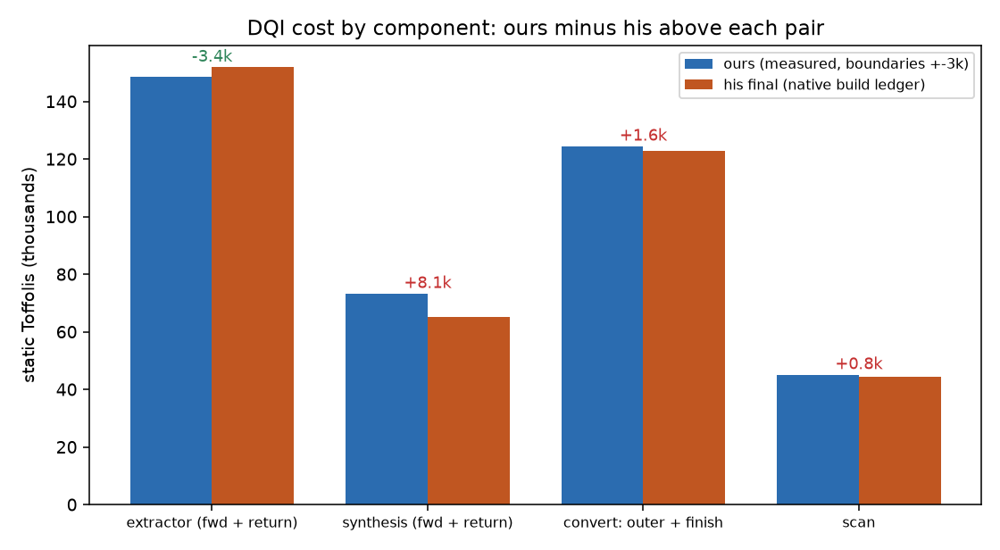
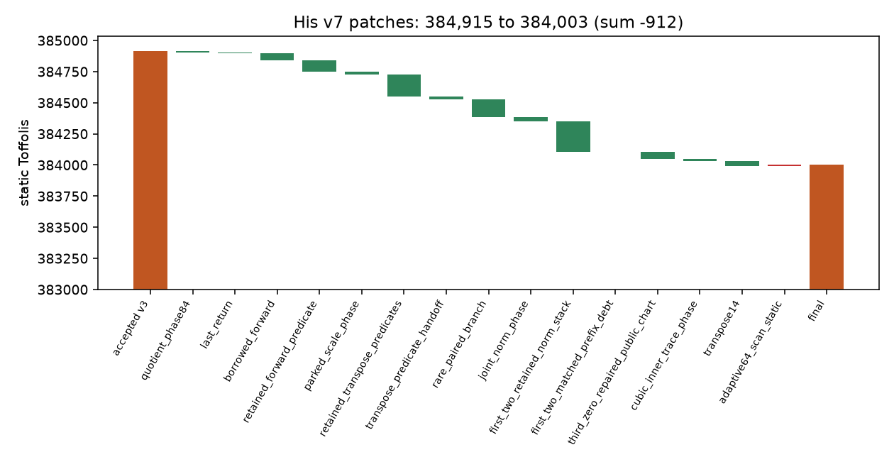
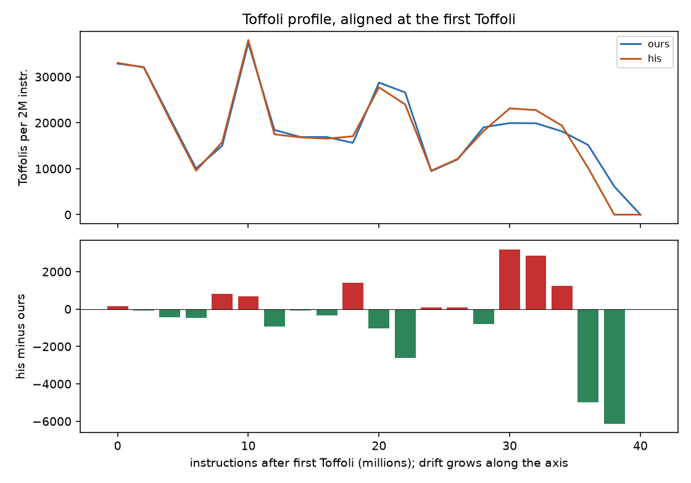
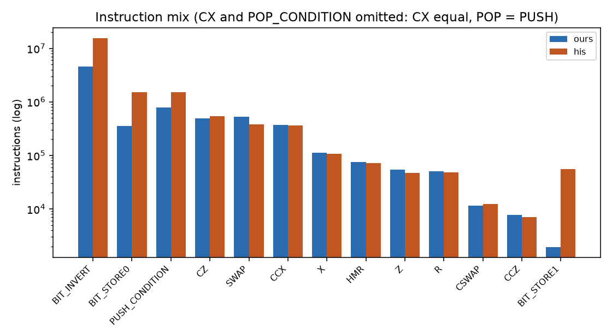
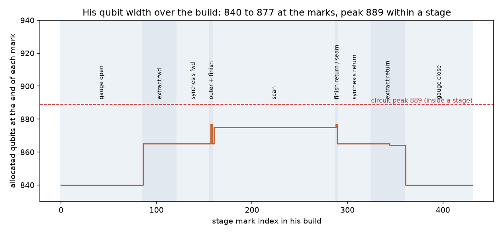

# DQI: how the 889-qubit builder is put together, and where our 2.1% is (QCC-19)

Method: read the source of the best public DQI builder (Apache-2.0) and one recorded build file as data; nothing from it was run.
Tags: **[V]** read from that source or its recorded data, cite file and line; **[M]** measured by us; **[I]** inferred.
Paths below are inside its `dqi_source/src/controller_work/`. Numbers behind every figure are in `analysis/numbers/dqi.json`
(`make report` redraws the figures and the PDF).

## Summary

* [V] Its circuit is 384,003 static Toffolis at 889 qubits; ours is 391,326 at 890 [M]. The 7,323 T gap is **not** one trick. It is
  6,411 T between our vendored base and the base of its final pipeline ("accepted v3", 384,915), plus 912 T of 15 small patches.
* [V] Our vendored kernels come from the older `night_c27` / `night_converter` lineage. Its final build rebinds about 15 modules from
  the newer `after_v3` / `after_c5` lineage (`after_v3/integration_v7/v7_pipeline.py:28-80`).
* [V] Three configuration choices we worried about are **not** the lever: `fused=False` (`v7_pipeline.py:288-289`), `j_min == 15`
  (`:278`), full-length scan with an adaptive 64-candidate gauge (`:281,294`).
* [M][V] Against its final native ledger (our own container run, section 7): extractor+synthesis +4.8k T, convert +1.6k, scan +0.8k, which is
  +7.1k of the 7.3k; the remainder is the error of our stage-boundary estimate.

## 1. Entry and structure [V]

`build.sh:81` runs `after_v3/integration_v7/gen_dqi.py`, which starts a memory guard and `build_v7.py`; that calls `v7_pipeline.emit`
(`v7_pipeline.py:275`). `emit` opens the adaptive gauge (`:281`), runs the key prefix (extract plus synthesis, `:286`), the outer stage
(`NewOuter.emit_prefix(..., fused=False)`, `:288-289`), the finish (`:290`), one adaptive scan (`:292`), then closes everything in
reverse order (`:297-310`). It passes a `stage=` callback through every call (`:285,291,298,313`), which gives a native per-stage mark;
our `fixed.py` has no such hook yet.

Build cost [V]: its README says peak about 1 GB, about 3 minutes on an Apple M5, and the generator refuses to start with less than
4 GB available (`README.md:38-42`). It needs CPython 3.13 and checks the SHA-256 of the competition `kickmix.so` and verifier file
(`build.sh:20-21,68-69`); both match our `data/` copies [M].

## 2. Configuration against ours [V]

| choice | his final | our `fixed.py` |
|---|---|---|
| outer stage `fused` | False (`v7_pipeline.py:288-289`) | False (`fixed.py:90`) |
| `j_min` | 15, asserted (`:278`) | 15 |
| scan | 4,026 point tests, static 44,286 T (`:294`, ledger arg `:173`) | 4,095 positions, 45,045 T (gauge off) |
| gauge | adaptive: 64 candidates, count cap 7, 69 fixed zero points, virtual pivot 70, 322 classical selector bits, 0 extra qubits (`:149-154`) | none |
| extractor | first-3 retained-norm adapter, special charts, deferred inverses (`:56-63`, `:119-130`) | `raw_query_extractor` from the older lineage |
| outer / convert | `transpose14` windows, handoff outer, paired and joint norm phases (`:34-41,64-69`) | `night_outer`, `projective_finish` |

## 3. Per-component static Toffolis

His component ledger is the one his own build prints (`build.json`, `/contract/source_ledger/components_static_T`) from our container run
(section 7), total 384,003. Ours is the measured profile of `fixed.kmb` with stage boundaries estimated to about +-3k T, so only sums of
adjacent components are robust.

| component | ours [M] | his final [V] | ours minus his |
|---|---:|---:|---:|
| extractor, forward + return | 148,500 | 151,852 | -3,352 |
| synthesis, forward + return | 73,200 | 65,076 | +8,124 |
| convert (outer + finish) | 124,400 | 122,789 | +1,611 |
| scan | 45,045 | 44,286 | +759 |
| total | 391,326 | 384,003 | +7,323 |

Extractor and synthesis together: ours 221,700, his 216,928, so **+4.8k**, which is the robust part (the two rows disagree in sign because
our extract/synthesis boundary is an estimate). Convert is +1.6k and the scan +0.76k (the 69 positions his gauge skips). The three add to
7.14k against the 7.32k total. Between his version-2 build (385,653) and the final one the extractor fell 739, the outer stage 922 and the
scan rose 11, together the -1,650 of section 4.

## 4. His final patches [V]

`source_ledger` (`v7_pipeline.py:173-216`) lists accepted v3 at 384,915 and 15 changes totalling -912 to reach 384,003. The largest are
`first_two_retained_norm_stack` -243, `retained_transpose_predicates` -176, `rare_paired_branch` -144 and
`retained_forward_predicate` -88; the adaptive scan adds +11. None needs a new idea about the algorithm; each is a local rewrite of how
a predicate or phase is held, so they are good candidates for the "mechanical" module-by-module path below.

## 5. The Toffoli-free wrapper [M], and what it is [I]

Both circuits were streamed once with `dqi_gen.study`. His has 11.2M instructions before the first Toffoli and 4.6M after the last; ours
0.4M and 0.25M. The interior lines up (instructions per 10% of T are 5.4/5.4, 4.8/4.8, 3.8/3.8 and 3.2/3.2 million in the middle
segments). His extra classical instruction mass (15.4M `BIT_INVERT` against 4.6M, 1.5M `BIT_STORE0` against 0.36M, twice the
`PUSH_CONDITION` blocks) therefore sits in the wrapper, not in the Toffoli region. [V] That wrapper is the gauge: his build marks show
70 `blocked_mask_shear` and 15 `adaptive64_histogram` stages before the extractor and 70 `blocked_mask_shear` after the return (section 8);
the 4,095 - 4,026 = 69 skipped positions explain the 759 T in the scan row.

Aligned at the first Toffoli, about 2.7k of the 7.3k gap falls in the first 28M instructions and about 4.6k later. The alignment drifts
along the axis, so this is a hint only.

## 6. What did not help [M]

* `fused=True` on our wiring fails (about 50% phase errors on the narrow instance): that mode needs history registers and our design is
  history free. His final also uses `fused=False`.
* `J_MIN` 17 saves 277 T (0.08%) with no errors; 19 saves 552 T but 2 value errors in 3,072 shots make the score 11.6% worse. The narrow
  instance has a different weight law, so 19 is not proven bad on the full instance, but the owner of the source keeps 15 (`:278`).

## 7. Reproducing his build here [M]

His builder rebuilds `dqi.kmb` byte for byte on this machine: `BUILT dqi.kmb 7cbe8ecf6f6e9743...`, 455,590,024 bytes, 78 to 87 s, well under
2 GB. It does not run on the host: the competition `kickmix.so` needs `GLIBCXX_3.4.32` and the host has glibc 2.35, so it runs inside a
rootless container (no network, inputs read-only, only the work and output directories writable) on a local image with glibc 2.39, using
CPython 3.13.13 and numpy 2.2.4 as his `build.sh` requires. `scripts/dqi_reference_build.sh` does this; the extracted source stays outside git
(52 MB, fetched with `scripts/fetch_public.sh`, extracted with `zipfile`).

Deviation, one line: `chmod -R u+w` on the copied tree is refused inside this container (reproduced with a plain `cp` and `chmod`, cause
unknown), so the script runs a copy of `build.sh` with `|| true` after it. The copy is already writable, the circuit hash is unchanged, and his
`build.sh` is not edited. Before running anything we read the launchers and grepped all 258 Python files for network, deletion and dynamic
execution (only `ast.literal_eval`, a method named `eval`, and one `exec` that compiles a function from the official verifier file).

## 8. His stage map and qubit width [V]

The build record keeps 432 stage marks with the builder's allocated-qubit count after each (`build.json`, `stages`). Order: gauge open (70
`blocked_mask_shear`, 15 `adaptive64_histogram`, one weight-gauge mark; width 840), extract forward (35 `raw_query_prefix`, width 865),
synthesis forward (34 marks), outer and finish (4 marks, 865 to 877), the scan (128 marks, 875), finish return and seam (3 marks, 877 to 865),
synthesis return (34), extract return (35, falling to 864), gauge close (70 `blocked_mask_shear`, width 840). The marks reach 877; his circuit
peak of 889 is reached inside a stage and is not recorded. The marks carry no Toffoli counts, so his per-stage T still has to come from the
ledger above or from a profile.

Consequence [I]: his width is 865 for most of the circuit and 889 only transiently, while our `fixed.kmb` showed ids 840 to 889 live through the
run. Whether ours could also drop below 890 for most stages is the next measurement (the same `num_allocated_qubits` read at each of our stage
marks).

## 9. Plan from here

1. **Match (path A), mostly done.** His pipeline is reproduced byte for byte in a container (section 7) and used as the oracle. We keep it
   out of git (its closure is 52 MB with hash-pinned records) and run it through `scripts/dqi_reference_build.sh`; the 58 modules already
   vendored stay as they are. Still to do: our own stage marks (below), then moving our generator onto his newer lineage.
2. **Own the parts we change (path B).** For each module we modify, rewrite it from scratch in `src/dqi_gen`, keep the vendored copy as
   the reference oracle, and require identical Toffoli count and a passing official verify before swapping it in.
3. **Exceed.** After the match, candidates (all estimates [G]): a lower-rank GF(2^24) product (about 1.3k T per unit of rank), a
   qubit-for-Toffoli trade in the extractor scratch (1 qubit is 879 T), and the open synthesis gap that his v3 base hides. Every step is
   measured as delta T, delta Q and delta cost at 10 salts, and added to `analysis/numbers/dqi.json`.

Not yet done: per-stage marks and allocated-qubit reads on our own build (needs the `stage=` hook), and provenance rows for the ideas above.
